<div align="center">

# Sentinel

### Stop deploying RAG toys.

**Sentinel is the self-healing, zero-trust agentic RAG engine with deterministic grounding, cost governance, and an automated regression ratchet.**

Every sentence it ships is cited and checked against the passage it cites. What it cannot verify, it refuses — and every refusal becomes a to-do item for whoever owns the documents. Every mistake a reader reports can become a permanent test that CI enforces.

[Quickstart](#60-second-quickstart) · [Why Sentinel](#why-sentinel) · [Architecture](#architecture) · [Benchmarks](#benchmarks--evals) · [Decisions](#architecture-decisions) · [Learn the codebase](docs/LEARNING_PATH.md)

`FastAPI` · `LangGraph` · `FAISS + BM25` · `Groq / OpenAI / Azure / Anthropic / Ollama` · `React + TypeScript` · `AWS free tier`

[](LICENSE)

</div>

---

## 60-second quickstart

You need Docker. You do not need Python, Node, an AWS account or, for the demo, an API key.

```bash
git clone https://github.com/92kareeem/Sentinel-Agentic-RAG.git
cd Sentinel-Agentic-RAG
cp .env.example .env        # optional: add a free Groq key from console.groq.com
docker compose up --build   # then open http://localhost:5173
```

On first start the API indexes the sample policy documents in [`corpus/`](corpus). Then (steps 2–4 call a real model, so they need a provider key in `.env`):

1. **Click _Chaos demo_** in the header and run all five attacks: prompt injection, PII leak, a planted hallucination, an out-of-scope question and budget exhaustion. Each card shows which layer stopped it, and the path the request took through the graph.
2. **Ask** _"What restocking fee applies in India?"_ and watch each verification stage stream in. Click a citation: your browser recomputes its SHA-256 and proves the quote is the exact span of the indexed file.
3. **Ask** _"What is the parental leave policy for contractors?"_ It refuses. Open **Control plane → Corpus gaps** and click **Upload the missing document & re-verify**: the question is asked again and now answers.
4. **Switch _Acting as_** to _Finance analyst_ and upload a document marked CONFIDENTIAL and shared with the `finance` role. Switch to _Contractor_ or _Other company_ and ask about it: it does not exist for them. The trace shows how many passages were hidden before anything was scored.

No key yet? The chaos demo still runs; model calls are replaced by deterministic stand-ins and labelled _simulated_. Fully air-gapped? `docker compose --profile ollama up` with `LLM_PROVIDER=local`.

---

## Why Sentinel?

Most RAG stacks fail in production the same three ways: a fluent answer that the evidence does not support, a cost or latency spike nobody bounded, and a mistake fixed once that quietly comes back. Sentinel is built around those three failures.

| | Naive RAG | Typical agentic RAG | **Sentinel** |
|---|---|---|---|
| **Is the answer supported?** | Trusts the model | An LLM judge grades the LLM | LLM critic **plus a deterministic grounding gate** that cannot hallucinate: every number in a claim must appear in the passage it cites, and wrong citations are re-pointed or stripped ([ADR 0003](docs/adr/0003-grounding-is-deterministic-not-only-an-llm-judge.md)) |
| **When it can't answer** | Guesses | Retries until something comes out | **Refuses, with a reason code.** A refusal is never repaired into a guess ([0001](docs/adr/0001-refusal-is-not-a-repairable-failure.md)) and never carries the rejected draft ([0005](docs/adr/0005-a-refusal-must-never-carry-the-draft-it-rejected.md)) |
| **Self-healing** | None | Loops on the same input | Bounded repair: one **search** rewrite that never alters the user's question ([0006](docs/adr/0006-the-search-query-is-not-the-users-question.md)), then one model escalation, then refusal |
| **Routing and cost** | One model | An LLM decides which LLM to call | A measured **heuristic router** ([0002](docs/adr/0002-router-uses-a-heuristic-not-an-llm.md)), hard token and deadline caps enforced *inside* provider calls, deterministic downgrade to the cheap model, per-call cost on every trace |
| **Access control** | Filter after search, if at all | Metadata filter on the top-k | **Tenant → role → clearance enforced before scoring**: FAISS gets an ID selector, so forbidden rows are never ranked ([0009](docs/adr/0009-access-is-enforced-before-scoring.md)) |
| **Provenance** | A chunk id | A chunk id | A **SHA-256 the reader can recompute**: file checksum, character span, text |
| **Streaming** | Raw tokens | Raw tokens | **Stage telemetry, never drafts.** The answer arrives only after it is verified ([0010](docs/adr/0010-streaming-carries-stages-not-drafts.md)) |
| **Learning from failure** | None | Logs | Every refusal is **diagnosed, clustered and ranked for the document owner** ([0007](docs/adr/0007-failures-are-recorded-as-a-corpus-work-list.md)) |
| **Not repeating mistakes** | None | An average eval score | A **per-question regression ratchet**: a reviewed failure becomes a test that, once it passes, fails CI if it ever comes back ([0008](docs/adr/0008-a-fixed-mistake-becomes-a-permanent-test.md)) |
| **Repeated questions** | Re-run | Semantic cache (can serve the wrong question's answer) | Cache of **verified** answers only, keyed by index version and caller visibility ([0011](docs/adr/0011-only-verified-answers-are-cached-keyed-by-index-version.md)) |

---

## Architecture

```mermaid
flowchart LR
    subgraph Ingress["Guardrail ingress (before any model)"]
        A[API key → tenant, roles, clearance] --> V[Size + schema] --> I[Injection screen] --> P[PII scrub] --> Q[Quota] --> B[Cost governor]
    end

    B --> C{Verified-answer<br/>cache}
    C -- hit --> OUT
    C -- miss --> R[Heuristic router]
    R --> RET[Snapshot hybrid retriever<br/>FAISS + BM25 → RRF<br/>access enforced before scoring]
    RET --> S[Synthesizer<br/>evidence fenced as untrusted]
    S -- INSUFFICIENT_CONTEXT --> RW
    S --> CR[LLM critic]
    CR -- pass --> G[Deterministic<br/>grounding gate]
    CR -- fail --> RW
    G -- fail --> RW
    RW[Repair:<br/>1 · rewrite search query<br/>2 · escalate model] --> RET
    RW -- budget or attempts spent --> REF[Refusal funnel<br/>reason code, no draft]
    G -- pass --> OUT[Verified, cited answer]

    OUT --> T[(Trace)]
    REF --> T
    T --> CB[Casebook<br/>diagnose · cluster]
    CB --> GAP[Corpus gap work list]
    GAP -. owner uploads the missing doc .-> RET
    CB --> RAT[Regression ratchet<br/>human review → pending → enforced]
    RAT -. CI fails if a fixed mistake returns .-> CI[(CI)]
```



**The flywheel.** The repair loop heals one request. The casebook remembers what failed and why. The gap report sends corpus failures to the person who can fix them. The ratchet makes each fix permanent. That last loop is what turns a demo into a product that improves.

### What each layer guarantees

| Layer | Module | Guarantee |
|---|---|---|
| Ingress | `guardrails/` | Injection patterns blocked, PII scrubbed before logs, traces or any provider, per-user quota, request budget allocated |
| Router | `agents/router.py` | Deterministic model choice; the trace records *who* decided |
| Retriever | `agents/retriever.py`, `rag/` | Reads one immutable index snapshot per request; unauthorized rows never scored |
| Synthesizer | `agents/synthesizer.py` | Document text is fenced and labelled untrusted data, never instructions |
| Critic | `agents/critic.py` | Verdicts are schema-validated; a malformed verdict fails closed and its tokens are still counted |
| Grounding | `guardrails/grounding.py` | Citations point at retrieved text; numbers appear in the cited passage; unsupported sentences stripped; mostly-stripped answers rejected |
| Refusal | `agents/graph.py` | One funnel, three reason codes, prose generated from the code |
| Providers | `llm/` | One retry core for Groq, OpenAI, Azure, Anthropic and local models; the deadline bounds every attempt and every backoff |
| Publication | `rag/index_store.py`, `rag/index_lock.py` | Immutable versioned index, atomic pointer swap, DynamoDB lease lock across instances |
| Lifecycle | `documents/registry.py` | Explicit state machine with compare-and-set writes; publish contention dead-letters to a retryable state |

---

## The control plane

One dialog, four tabs, for whoever operates the system:

- **Telemetry**: p50 and p95 latency, token burn per hour, estimated cost per answer, refusal, cache-hit and self-repair rates, budget downgrades, a per-node time and token profile, and hourly volume. All of it is computed on read from traces, so it costs nothing while nobody looks.
- **Corpus gaps**: unanswered and reader-flagged questions, clustered by topic and ranked by frequency, each with the recommended fix and a one-click upload that re-asks the question.
- **Quality ratchet**: failures waiting for review, promotion to a pending test with a reviewed reference answer, retirement with a reason, and the exact CLI command when the suite lives in git.
- **Traces**: every request drawn as lanes of attempts, with what each node did, how long it took, what it cost, and where it repaired.

---

## Benchmarks & evals

Two suites, two kinds of gate, both in [`evals/`](evals):

| Suite | Gate | Question it answers |
|---|---|---|
| `golden_dataset.json` (20 questions, 3 unanswerable) | **Averages**: faithfulness ≥ 0.75, unanswerable refusal ≥ 2/3 | Is the system good overall? |
| `regressions.json` (grows from real failures) | **Per question**: every enforced item must pass | Did a mistake we already fixed come back? |

Last full run (`evals/report.md`, judge `openai/gpt-oss-20b`):

| Metric | Value |
|---|---|
| Mean faithfulness (judged against retrieved context, [ADR 0004](docs/adr/0004-faithfulness-is-judged-against-context-not-the-reference.md)) | **1.000** |
| Mean completeness (judged against the reference) | 1.000 |
| Retrieval hit-rate (top-5) | 100% |
| Unanswerable questions refused | 3 / 3 |
| False refusals on answerable questions | 0 / 17 |
| Mean tokens per query | 1,417 |

Measured improvements behind the decisions: refusal short-circuit took p95 from 25.3 s to 12.1 s ([0001](docs/adr/0001-refusal-is-not-a-repairable-failure.md)); retiring the LLM router removed a false refusal and 14% of tokens ([0002](docs/adr/0002-router-uses-a-heuristic-not-an-llm.md)).

```bash
make eval            # golden set + ratchet, live model; writes evals/report.md
make regressions     # just the ratchet, e.g. after a fix
python evals/promote.py list                  # failures not yet tests
python evals/promote.py promote <case_id>     # reviewed failure -> pending test
python evals/promote.py retire R001 --reason "policy changed"
```

The eval workflow runs nightly and on PRs labelled `run-evals`. Every PR runs the unit suites, lint, types, the frontend build, the Lambda image build and start, and a `docker compose up` smoke test that asserts every chaos scenario is caught.

### Load test

Measured with JMeter against one API process capped at 2 CPUs, with a stand-in model
answering in 300 ms so the numbers are Sentinel's own cost, not a provider's rate limit
([method](benchmarks/README.md), [full report](docs/benchmarks/2026-11-15/README.md)).
A rate counts as sustained when errors stay at or under 1% and p95 stays under 250 ms
(no model call) or 2 s (full answer).

| Scenario | Sustained | p95 at that rate |
|---|---:|---:|
| Health check | 989/s | 114 ms |
| Prompt injection blocked before any model call | 989/s | 56 ms |
| Repeated question, served from the verified-answer cache | 248/s | 13 ms |
| New question, full verified answer (retrieval, two model calls, grounding gate) | 49/s | 1.6 s |
| New question, streamed | 39/s | 1.0 s |

The first run found full answers capped at 10/s: every model call built a new HTTP
client (SSL context, DNS, TCP connect), and the embedding engine spun eight threads in
a two-CPU container. Fixing both cut CPU per answer from ~140 ms to ~23 ms, which
raised full answers to 49/s, five times the original rate.

```bash
make bench           # needs Java 17+ and JMeter 5.6+; ~20 minutes
```

---

## Choose your model

Set `LLM_PROVIDER` in `.env`. Every adapter shares one retry, deadline and circuit-breaker core, so failure behaviour is identical across vendors.

| Provider | `LLM_PROVIDER` | Notes |
|---|---|---|
| Groq | `groq` (default) | Free tier, very low latency. `openai/gpt-oss-20b` and `-120b` by default |
| OpenAI | `openai` | `OPENAI_API_KEY`, `OPENAI_MODEL_SIMPLE/COMPLEX` |
| Azure OpenAI | `azure` | `AZURE_OPENAI_ENDPOINT`, deployment names as models |
| Anthropic | `anthropic` | `ANTHROPIC_API_KEY`, `ANTHROPIC_MODEL_SIMPLE/COMPLEX` |
| Local / air-gapped | `local` | Ollama or vLLM (OpenAI-compatible); `docker compose --profile ollama up` |

Prices for cost telemetry live in `backend/app/llm/pricing.py` and can be corrected with `LLM_PRICING_OVERRIDES` without a release.

---

## Access control

Every document has a **tenant**, the **roles** it is shared with (empty means only the uploader and tenant admins), and a **classification**: `PUBLIC < INTERNAL < CONFIDENTIAL < RESTRICTED`. A caller sees a document when it is in their tenant, they own it or hold a matching role or are a tenant admin, and their clearance is at least its level. Anything else is a 404, never a 403.

Local mode ships five identities for trying this from the browser:

| API key | Identity |
|---|---|
| `demo-local` | acme · employee · INTERNAL |
| `finance-local` | acme · finance · CONFIDENTIAL |
| `contractor-local` | acme · contractor · PUBLIC |
| `admin-local` | acme · tenant admin · RESTRICTED |
| `globex-local` | globex · employee · INTERNAL |

---

## Deploy on the AWS free tier

The same code runs serverless with `STORAGE_BACKEND=aws`: Lambda (container image, ONNX embeddings, no torch) behind a Function URL, DynamoDB for registry, casebook, traces, quotas and the publication lock, S3 for versioned index artifacts and uploads, SSM SecureString for the provider key, and CloudFront for the UI.

```bash
export AWS_ACCOUNT_ID=... AWS_REGION=ap-south-1
aws ssm put-parameter --name /sentinel/groq-api-key --type SecureString --value <key>
make ingest && make deploy     # idempotent; ends with a /healthz smoke test
python infra/seed_users.py     # issues hashed API keys
```

[`infra/deploy.sh`](infra/deploy.sh) creates or updates every resource with a least-privilege IAM role and no wildcards. Nothing runs on a schedule: telemetry and gap reports are computed on read, so an idle deployment costs nothing.

---

## Run it without Docker

```bash
make install        # venv (outside OneDrive on Windows) + frontend deps
make ingest         # index ./corpus
make serve          # API on :8000 with the chaos demo enabled
make web            # UI on :5173
make check          # lint, types, backend and frontend tests
```

---

## Architecture decisions

Every non-obvious choice is written down with the measurement behind it and the alternatives it rules out.

| ADR | Decision |
|---|---|
| [0001](docs/adr/0001-refusal-is-not-a-repairable-failure.md) | A refusal is an outcome, not a failure to repair |
| [0002](docs/adr/0002-router-uses-a-heuristic-not-an-llm.md) | The router uses a heuristic, not an LLM call |
| [0003](docs/adr/0003-grounding-is-deterministic-not-only-an-llm-judge.md) | Grounding is deterministic, and deliberately weak |
| [0004](docs/adr/0004-faithfulness-is-judged-against-context-not-the-reference.md) | Faithfulness is judged against retrieved context |
| [0005](docs/adr/0005-a-refusal-must-never-carry-the-draft-it-rejected.md) | A refusal never carries the draft it rejected |
| [0006](docs/adr/0006-the-search-query-is-not-the-users-question.md) | The search query is not the user's question |
| [0007](docs/adr/0007-failures-are-recorded-as-a-corpus-work-list.md) | Failures become a work list for the document owner |
| [0008](docs/adr/0008-a-fixed-mistake-becomes-a-permanent-test.md) | A fixed mistake becomes a permanent test |
| [0009](docs/adr/0009-access-is-enforced-before-scoring.md) | Access is enforced before scoring |
| [0010](docs/adr/0010-streaming-carries-stages-not-drafts.md) | Streaming carries stages, never drafts |
| [0011](docs/adr/0011-only-verified-answers-are-cached-keyed-by-index-version.md) | Only verified answers are cached |

New to the code? Follow the [learning path](docs/LEARNING_PATH.md): ten checkpoints, each with an offline exercise.

---

## Known limitations

Stated plainly, because a system whose guarantees are precisely scoped is more trustworthy than one whose guarantees are overstated.

- **Grounding is lexical, not semantic.** It catches unsupported numbers, fabricated citations and claims unrelated to their evidence. Whether a passage *entails* a claim is the critic's job, and the critic can be wrong ([ADR 0003](docs/adr/0003-grounding-is-deterministic-not-only-an-llm-judge.md)).
- **No OCR.** Scanned PDFs are rejected with `UNSUPPORTED_SCANNED_DOCUMENT` rather than indexed as empty.
- **Follow-up questions are not resolved before retrieval.** "What about contractors?" is searched literally.
- **Whole-document questions use top-k.** "List every exception" gets the most similar passages, not all of them.
- **Supersession is not modelled.** Two documents giving different refund windows are both evidence.
- **Identity is an API key mapped to a user record.** There is no SSO or OIDC yet; the browser holds a quota-limited demo key.
- **On Lambda, streaming is buffered** by the Function URL adapter: the result is identical, but progress arrives at the end. The answer cache is per warm container.
- **Regressions run against the eval corpus.** Per-tenant regression runs against each tenant's own index are not built.
- **A tenant-wide document listing in AWS is a filtered scan.** A `tenant_id` index is the upgrade at volume.

---

## Repository layout

```
backend/app/agents/        LangGraph nodes and routing (graph.py is the whole state machine)
backend/app/guardrails/    auth, access, injection, PII, quota, cost governor, grounding
backend/app/llm/           provider adapters over one resilient HTTP core, pricing
backend/app/rag/           chunking, PDF, embeddings, FAISS/BM25, snapshots, cache, publication
backend/app/learning/      casebook (failures → work list) and ratchet (fixes → tests)
backend/app/api/           query pipeline, streaming, control plane, documents, chaos demo
frontend/                  React + TypeScript UI and control plane
evals/                     golden set, regression suite, judge prompts, promotion CLI
benchmarks/                JMeter load test, stand-in model, runner and report builder
corpus/                    the sample business documents that get indexed
docs/                      system guide, ADRs, learning path, benchmark reports (never indexed)
docker/ · infra/           compose images, Lambda image, idempotent AWS deploy
```

---

## License

Sentinel is licensed under the [GNU Affero General Public License v3.0](LICENSE) (AGPL-3.0-only).

You may use, modify and self-host it, including commercially. If you run a
modified version as a network service, you must offer its users the source of
your modifications under the same license. The PDF parser, PyMuPDF, is itself
AGPL-3.0, which is why the project uses the same license.

---

<div align="center">

Built by [Syed Abdul Kareem Ahmed](https://linkedin.com/in/92kareem). If Sentinel saves you from shipping a confident wrong answer, a ⭐ helps others find it.

</div>
