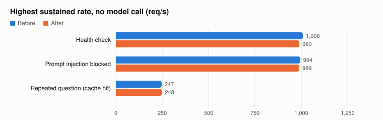
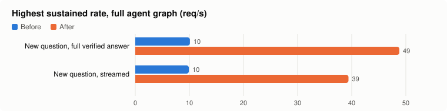
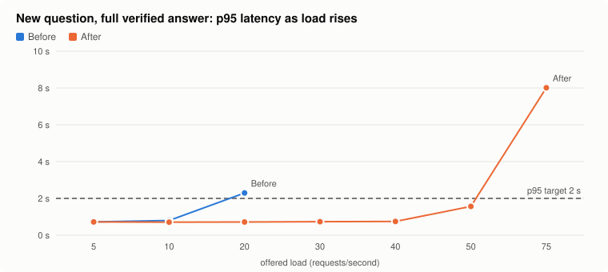
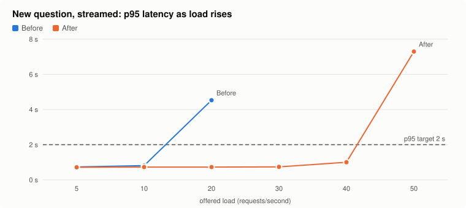

# Load test — 2026-11-15

## Highest sustained rate

| Scenario | Before | After | p95 at that rate (after) |
|---|---:|---:|---:|
| Health check | 1,008/s | **989/s** | 114 ms |
| Prompt injection blocked | 994/s | **989/s** | 56 ms |
| Repeated question (cache hit) | 247/s | **248/s** | 13 ms |
| New question, full verified answer | 10/s | **49/s** | 1566 ms |
| New question, streamed | 10/s | **39/s** | 1000 ms |

A step passes when errors stay at or under 1%, the server delivers at least 90% of the
offered rate, and p95 latency stays under 250 ms for requests that never reach a model
or 2 s for a full answer. `+` means the staircase ran out before the system did.

## What changed

The first run found that full answers saturated at about 10 per second, with the
API spending ~125–150 ms of CPU per answer while the two model calls it waits on
take 600 ms of wall time. A sampling profile (py-spy) under load showed where:

| Share of busy CPU | Where | Cause |
|---:|---|---|
| ~40% | SSL context, DNS lookup, TCP connect, socket close | a new HTTP client for every model call |
| ~10% | ONNX Runtime | one embedding thread per host core (8) in a 2-CPU container, spin-waiting |
| a few % | trace and counter files | local-mode bookkeeping (not changed here) |

Two changes, both in this PR:

1. **One pooled HTTP client per process** (`backend/app/llm/http_chat.py`). Model
   calls reuse keep-alive connections. Against a hosted provider this also removes
   a TLS handshake from every call, so the gain in production is larger than the
   plain-HTTP stand-in shows here.
2. **ONNX sized for request-level concurrency** (`backend/app/rag/embeddings.py`,
   `EMBED_THREADS`, default 1). A query embeds one short sentence; parallelism
   belongs across requests, and idle threads now sleep instead of spinning.

Result: about **23 ms of CPU per answer** (from ~125–150), full answers sustained at
**49/s** (from 10/s), streamed answers at **39/s** (from 10/s), and p95 at 20/s down
from 2.29 s to 0.72 s. Paths that never reach a model were unaffected, as expected: the
one- or two-percent differences on those rows are run-to-run noise.

**Where the next limit is.** One uvicorn process: health checks top out near 1,000/s
and cache hits near 250/s with that process at a full core. Cache hits do more than
health checks — every guardrail, a trace write and the daily counters run on each
one — and local mode rewrites the counters file per request. In AWS those are single
DynamoDB writes, and Lambda scales by instance, so per-instance numbers are the
ones to compare.

## Latency under load

## Every step

### Health check

| Offered/s | Delivered/s | p50 | p95 | p99 | Errors | API CPU (100% = 1 core) | Result |
|---|---|---|---|---|---|---|---|
| 100 | 99.6 | 3 ms | 6 ms | 8 ms | 0.00% | 11% | ok |
| 250 | 249.8 | 5 ms | 8 ms | 11 ms | 0.00% | 28% | ok |
| 500 | 495.4 | 7 ms | 12 ms | 41 ms | 0.00% | 44% | ok |
| 750 | 743.3 | 9 ms | 17 ms | 67 ms | 0.00% | 73% | ok |
| 1000 | 989.4 | 76 ms | 114 ms | 143 ms | 0.00% | 103% | ok |
| 1500 | 970.8 | 117 ms | 162 ms | 197 ms | 0.00% | 103% | limit: delivered 64.7% of offered |

Before

| Offered/s | Delivered/s | p50 | p95 | p99 | Errors | API CPU (100% = 1 core) | Result |
|---|---|---|---|---|---|---|---|
| 100 | 99.1 | 3 ms | 6 ms | 9 ms | 0.00% | 13% | ok |
| 250 | 250.2 | 5 ms | 8 ms | 13 ms | 0.00% | 26% | ok |
| 500 | 497.0 | 7 ms | 12 ms | 41 ms | 0.00% | 46% | ok |
| 750 | 744.6 | 10 ms | 30 ms | 74 ms | 0.00% | 71% | ok |
| 1000 | 1008.2 | 14 ms | 87 ms | 116 ms | 0.00% | 88% | ok |
| 1500 | 982.1 | 114 ms | 169 ms | 192 ms | 0.00% | 104% | limit: delivered 65.5% of offered |

### Prompt injection blocked

| Offered/s | Delivered/s | p50 | p95 | p99 | Errors | API CPU (100% = 1 core) | Result |
|---|---|---|---|---|---|---|---|
| 100 | 97.7 | 3 ms | 5 ms | 6 ms | 0.00% | 14% | ok |
| 250 | 249.4 | 4 ms | 6 ms | 8 ms | 0.00% | 20% | ok |
| 500 | 499.0 | 6 ms | 9 ms | 22 ms | 0.00% | 33% | ok |
| 750 | 746.2 | 7 ms | 14 ms | 59 ms | 0.00% | 50% | ok |
| 1000 | 989.2 | 9 ms | 56 ms | 84 ms | 0.00% | 60% | ok |
| 1500 | 1282.1 | 128 ms | 190 ms | 220 ms | 0.00% | 92% | limit: delivered 85.5% of offered |

Before

| Offered/s | Delivered/s | p50 | p95 | p99 | Errors | API CPU (100% = 1 core) | Result |
|---|---|---|---|---|---|---|---|
| 100 | 98.9 | 3 ms | 5 ms | 6 ms | 0.00% | 11% | ok |
| 250 | 248.1 | 4 ms | 6 ms | 9 ms | 0.00% | 23% | ok |
| 500 | 499.2 | 6 ms | 9 ms | 26 ms | 0.00% | 31% | ok |
| 750 | 742.4 | 7 ms | 15 ms | 69 ms | 0.00% | 50% | ok |
| 1000 | 994.0 | 9 ms | 74 ms | 93 ms | 0.00% | 64% | ok |
| 1500 | 1172.0 | 144 ms | 212 ms | 232 ms | 0.00% | 92% | limit: delivered 78.1% of offered |

### Repeated question (cache hit)

| Offered/s | Delivered/s | p50 | p95 | p99 | Errors | API CPU (100% = 1 core) | Result |
|---|---|---|---|---|---|---|---|
| 100 | 98.7 | 5 ms | 9 ms | 13 ms | 0.00% | 17% | ok |
| 250 | 248.2 | 7 ms | 13 ms | 55 ms | 0.00% | 46% | ok |
| 500 | 425.6 | 135 ms | 183 ms | 210 ms | 0.00% | 100% | limit: delivered 85.1% of offered |

Before

| Offered/s | Delivered/s | p50 | p95 | p99 | Errors | API CPU (100% = 1 core) | Result |
|---|---|---|---|---|---|---|---|
| 100 | 98.7 | 5 ms | 8 ms | 12 ms | 0.00% | 17% | ok |
| 250 | 246.8 | 7 ms | 14 ms | 25 ms | 0.00% | 47% | ok |
| 500 | 443.4 | 130 ms | 161 ms | 214 ms | 0.00% | 101% | limit: delivered 88.7% of offered |

### New question, full verified answer

| Offered/s | Delivered/s | p50 | p95 | p99 | Errors | API CPU (100% = 1 core) | Result |
|---|---|---|---|---|---|---|---|
| 5 | 4.7 | 634 ms | 723 ms | 740 ms | 0.00% | 11% | ok |
| 10 | 10.1 | 624 ms | 710 ms | 726 ms | 0.00% | 24% | ok |
| 20 | 20.1 | 630 ms | 716 ms | 733 ms | 0.00% | 45% | ok |
| 30 | 29.6 | 644 ms | 734 ms | 761 ms | 0.00% | 72% | ok |
| 40 | 40.4 | 653 ms | 750 ms | 808 ms | 0.00% | 98% | ok |
| 50 | 48.8 | 925 ms | 1566 ms | 1673 ms | 0.00% | 144% | ok |
| 75 | 67.3 | 6917 ms | 8015 ms | 8097 ms | 0.00% | 160% | limit: delivered 89.7% of offered; p95 over 2,000 ms |

Before

| Offered/s | Delivered/s | p50 | p95 | p99 | Errors | API CPU (100% = 1 core) | Result |
|---|---|---|---|---|---|---|---|
| 5 | 5.2 | 645 ms | 722 ms | 764 ms | 0.00% | 78% | ok |
| 10 | 10.1 | 671 ms | 801 ms | 850 ms | 0.00% | 126% | ok |
| 20 | 19.8 | 1307 ms | 2294 ms | 2724 ms | 0.00% | 166% | limit: p95 over 2,000 ms |

### New question, streamed

| Offered/s | Delivered/s | p50 | p95 | p99 | Errors | API CPU (100% = 1 core) | First byte p95 | Result |
|---|---|---|---|---|---|---|---|---|
| 5 | 4.7 | 636 ms | 712 ms | 728 ms | 0.00% | 12% | 6 ms | ok |
| 10 | 9.2 | 636 ms | 728 ms | 758 ms | 0.00% | 27% | 8 ms | ok |
| 20 | 20.2 | 646 ms | 727 ms | 743 ms | 0.00% | 49% | 12 ms | ok |
| 30 | 28.4 | 653 ms | 736 ms | 759 ms | 0.00% | 84% | 13 ms | ok |
| 40 | 39.4 | 701 ms | 1000 ms | 1128 ms | 0.00% | 119% | 84 ms | ok |
| 50 | 48.1 | 5381 ms | 7293 ms | 7567 ms | 0.00% | 147% | 2206 ms | limit: p95 over 2,000 ms |

Before

| Offered/s | Delivered/s | p50 | p95 | p99 | Errors | API CPU (100% = 1 core) | First byte p95 | Result |
|---|---|---|---|---|---|---|---|---|
| 5 | 4.8 | 641 ms | 734 ms | 749 ms | 0.00% | 88% | 27 ms | ok |
| 10 | 9.9 | 688 ms | 810 ms | 891 ms | 0.00% | 131% | 59 ms | ok |
| 20 | 19.8 | 3648 ms | 4530 ms | 4718 ms | 0.00% | 172% | 1003 ms | limit: p95 over 2,000 ms |

## Environment

| | |
|---|---|
| Date | 2026-11-15 07:26 UTC |
| Code under test | main @ 5858b3e + pooled LLM client + ONNX thread sizing |
| Commit | 5858b3e |
| Host CPU | 11th Gen Intel(R) Core(TM) i5-11320H @ 3.20GHz |
| Host logical CPUs | 8 |
| Host OS | Windows 11 |
| Docker | 29.9.2 |
| API container CPU limit | 2 |
| API worker processes | 1 |
| Stand-in model latency per call (ms) | 300 |
| Load generator | apache-jmeter-5.6.3 |
| Seconds per step | 30 |
| Warm-up excluded (s) | 5 |
| A step passes when | errors <= 1%, delivered >= 90% of the offered rate, p95 under 250 ms (no model call) or 2 s (full answer) |

Raw data: [`summary.json`](summary.json) · [`baseline-summary.json`](baseline-summary.json)
